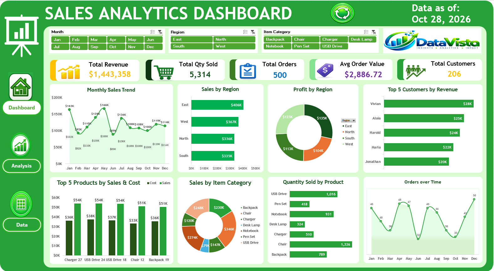

# Sales Analytics Dashboard

**Excel Sales Analytics & Interactive Dashboard**

An Excel-based sales analytics project exploring revenue, profitability, regional performance, product sales, and order trends across a 2026 reporting period.

The project transforms order-level data into an interactive dashboard featuring executive KPIs, monthly sales trends, regional comparisons, product-level analysis, and order performance indicators.

---

## Dashboard Preview



*Interactive sales performance dashboard developed in Microsoft Excel.*

---

## Project Overview

This project demonstrates how a sales dataset can be organized and analyzed using Microsoft Excel to create a structured business intelligence report.

The workbook combines:

- Data organization and preparation
- Calculated sales and profit fields
- KPI calculations
- PivotTables
- PivotCharts
- Regional performance analysis
- Product-level analysis
- Time-series analysis
- Dashboard design and formatting

The dashboard brings key sales indicators together in one place, allowing users to explore performance across regions, products, and time.

---

## Key Performance Areas

### 01. Executive Sales Performance

The dashboard summarizes overall sales performance using the following indicators:

- Total revenue
- Total quantity sold
- Total orders
- Average order value
- Unique customer names

The customer-name metric counts distinct name values in the dataset. It should not be interpreted as a verified count of unique individuals because customer IDs and names were found to be inconsistent.

### 02. Monthly Sales Trend

The project examines monthly revenue patterns from January to December 2026.

The analysis helps users explore:

- Changes in monthly sales
- Higher and lower revenue periods
- Sales fluctuations throughout the year
- Overall monthly performance patterns

### 03. Regional Sales Analysis

Sales performance is compared across four regions:

- East
- West
- North
- South

The analysis identifies differences in regional revenue and helps compare sales contributions across the reporting period.

### 04. Regional Profitability

The dashboard compares profit across the four regions.

This analysis provides a view of how recorded profit is distributed geographically and allows users to compare regional sales performance with profitability.

### 05. Product-Level Sales and Cost Analysis

The project examines sales and cost at the individual product level.

The analysis includes:

- Top five products by sales
- Sales versus cost comparisons
- Product-level revenue contribution
- Differences between recorded sales and costs

Product-level comparisons use the Product Name field because the reviewed Product ID and Product Name mappings were consistent.

### 06. Quantity Sold by Product

The dashboard compares quantities sold across individual product groups.

This helps identify products with higher recorded unit volumes and provides another perspective on sales performance beyond revenue alone.

### 07. Order Trends

The dashboard includes an order-trend visual showing the distribution of recorded orders across the months of 2026.

This allows users to compare monthly order activity and examine fluctuations in transaction volume.

---

## Interactive Dashboard

The dashboard combines KPI cards and Excel chart-based reporting to present the main performance indicators in a single view.

### Dashboard Components

| Component | Purpose |
|---|---|
| Total Revenue | Summarizes recorded sales revenue |
| Total Quantity Sold | Shows the total number of units sold |
| Total Orders | Counts recorded orders |
| Average Order Value | Shows average revenue per order |
| Monthly Sales Trend | Compares revenue across months |
| Sales by Region | Compares regional revenue |
| Profit by Region | Compares regional profit |
| Top 5 Products by Sales & Cost | Compares sales and costs for leading products |
| Quantity Sold by Product | Compares recorded unit volumes |
| Orders over Time | Examines monthly order activity |

---

## Dataset

The dataset contains **500 order records** covering the period from 1 January 2026 to 31 December 2026.

The workbook includes order, customer, product, pricing, cost, and calculated performance fields.

### Main Variables

| Variable | Description |
|---|---|
| Order ID | Identifier for an order record |
| Order Date | Date of the order |
| Year | Calendar year of the order |
| Customer ID | Recorded customer identifier |
| Customer Name | Recorded customer name |
| Product ID | Product identifier |
| Product Name | Recorded product name |
| Item Category | Recorded product category |
| Quantity Sold | Number of units sold |
| Unit Price | Price per unit |
| Cost Amount | Recorded cost amount |
| Sales Amount | Calculated sales revenue |
| Profit | Sales amount minus cost amount |
| Quarter | Calendar quarter |
| Month | Month of the order |
| Month No | Numeric month value |

---

## Key Performance Indicators

The following figures were calculated or verified against the workbook's source data.

| KPI | Value |
|---|---:|
| Total Revenue | $1,443,357.97 |
| Total Profit | $475,892.63 |
| Total Orders | 500 |
| Total Quantity Sold | 5,314 |
| Average Order Value | $2,886.72 |
| Reporting Period | January–December 2026 |

*Values are based on the workbook and are subject to the data-quality limitations described below.*

---

## Data Quality Considerations

The original dataset was found without accompanying documentation. Its source and real-world validity could not be independently verified.

During validation, the following limitations were identified:

- Customer IDs were associated with multiple customer names.
- Product categories did not consistently correspond to product names.
- Customer-level results could not be confidently interpreted as unique individuals.
- Category-level comparisons could be misleading because the category assignments were inconsistent.

The original data was preserved rather than changing customer identities or category assignments without a reliable reference.

The customer-name metric therefore represents distinct name values, not verified unique customers. Product-level analysis uses Product Name rather than Item Category.

These limitations should be considered when interpreting the results. The project demonstrates both Excel dashboard development and the importance of validating source data before drawing business conclusions.

---

## Analytical Questions

The dashboard was designed to explore questions such as:

1. What is the total revenue generated during the reporting period?
2. How much profit is recorded across all orders?
3. How does revenue change from month to month?
4. Which region contributes the most to total sales?
5. How does profit vary across regions?
6. Which individual products have the highest sales?
7. How do sales and costs compare for the leading products?
8. Which products have the highest recorded quantities sold?
9. How does monthly order activity fluctuate throughout the year?
10. What data-quality limitations should be considered before making customer-level or category-level decisions?

---

## Excel Skills Demonstrated

### Data Preparation & Analysis

- Structured data organization
- Calculated columns
- Structured-reference formulas
- Sales and profit calculations
- Date-based analysis
- Data-quality validation
- Regional analysis
- Product-level analysis

### Excel Reporting

- Excel Tables
- PivotTables
- PivotCharts
- KPI development
- Chart formatting
- Dashboard layout and design
- Business performance reporting
- Data visualization

---

## Tools

**Microsoft Excel**

Key features used:

- Excel Tables
- Excel formulas
- Structured references
- PivotTables
- PivotCharts
- KPI calculations
- Dashboard formatting
- Data visualization

---

## Analytical Workflow

```text
Source Sales Dataset
        ↓
Data Organization
        ↓
Calculated Sales & Profit
        ↓
Data Quality Validation
        ↓
PivotTables
        ↓
PivotCharts
        ↓
KPI Development
        ↓
Interactive Sales Dashboard
```

---

## Project Purpose

The purpose of this project is to demonstrate practical Excel data-analysis, reporting, and dashboard-development skills using an order-level sales dataset.

The dashboard transforms individual order records into a visual report that allows users to explore revenue, profitability, regional performance, product-level results, and monthly trends.

The project also demonstrates the importance of investigating inconsistent source data and documenting limitations before presenting analytical findings.

The same Excel techniques can be adapted to other business domains, including marketing, finance, retail, and operations.

---

## Repository Contents

- `Sales Analytics Dataset_copy.xlsm` — Excel workbook containing the source data, analysis, PivotTables, and dashboard.
- `data/` — Supporting dataset files, if included.
- `images/dashboard.png` — Dashboard screenshot.
- `images/analysis.png` — Analysis screenshot.
- `images/data.png` — Source data screenshot.
- `README.md` — Project documentation.

---

## Author

**Rachel Konadu Gyamfi**

Data Analyst | Excel | SQL | Python | Power BI

---

## Connect

- **LinkedIn:** https://linkedin.com/in/rachel-konadu-gyamfi
- **GitHub:** https://github.com/cyber-rachel
